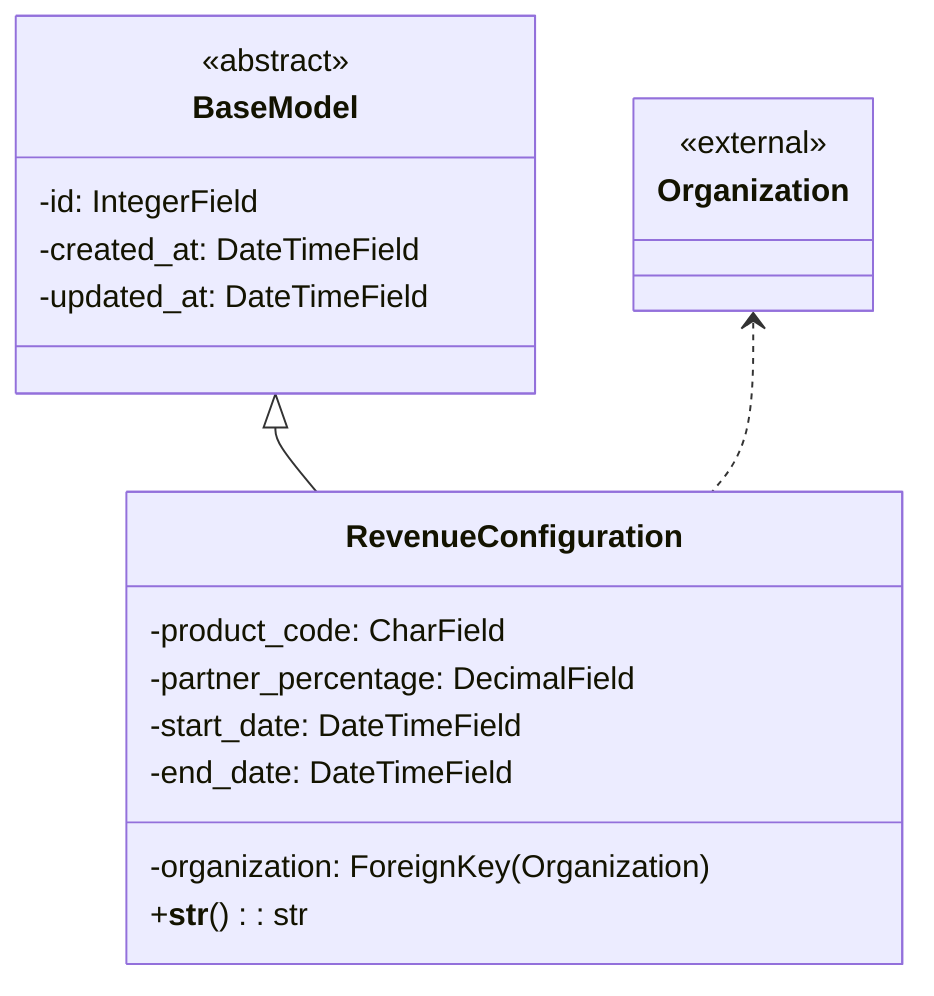

# Shared Revenue Module

Descripton:
This module is responsible for handling shared revenue between organizations.

## ERD of models



## Export the split revenue report

The split revenue report is a xlsx file with two sheets, the split of each transaction of a period
and the revenue configurations used to calculate it.

### From the admin

1. Open `Shared_Revenue > Revenue configurations` in the admin.
2. Click on `Export split revenue report`.
3. Choose the start and end dates, both included and in UTC, and optionally an organization and a product id.
4. Click on `Export`, the report is downloaded by the browser. It is not saved in the storage.

The user needs to be staff and to have the `shared_revenue | Revenue configuration | Can export the split revenue report`
permission. To reach the page from the revenue configurations list, the user also needs the
`Can view Revenue configuration` permission.

### From the command line

The commands save the report in the configured storage. As in the admin, the start and end dates are
both included and in UTC, so the example below exports the whole month of December.

```bash
python manage.py export_split_revenue 2023-12-01 2023-12-31 --organization_code=ORG --product_id=course-v1:ORG+COURSE+2023_T3
python manage.py export_split_revenue_per_organizations 2023-12-01 2023-12-31 --send_email=true --bcc="bcc1@email.com bcc2@email.com"
```
